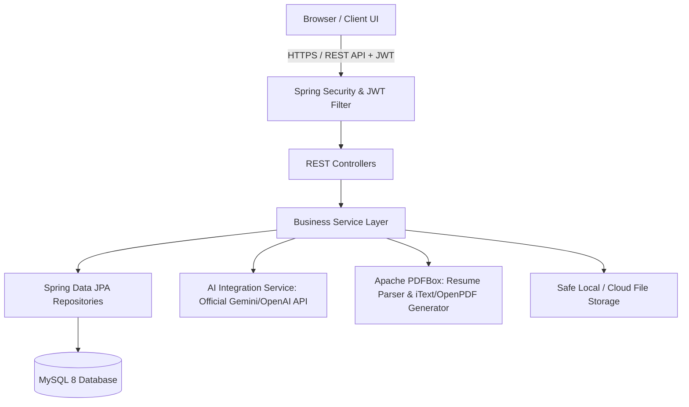

# System Architecture & Design Specification

## 1. System Overview & Architecture

Layered architecture with decoupled Frontend (React + Vite) and Backend (Java Spring Boot 3 + MySQL):

### Key Components:
1. **Frontend (Presentation Layer)**:
   - React 18 with Vite
   - React Router v6 for RBAC Protected Routes
   - Axios with Bearer Interceptor
   - Recharts for Placement Analytics & KPIs
   - Teximo AI Floating Chat Widget with Elephant avatar
2. **Backend (Application & API Layer)**:
   - Java 21 / Spring Boot 3.3+
   - Spring Security with Stateless JWT Filter (`OncePerRequestFilter`)
   - Bean Validation (`jakarta.validation.*`)
   - Global Exception Handler (`@RestControllerAdvice`)
   - Apache PDFBox for secure text extraction
   - Spring AI / HTTP Client for LLM Career & Resume Guidance
3. **Data Layer**:
   - MySQL 8 with Hibernate/JPA schema migration & constraints
   - Connection Pooling via HikariCP
